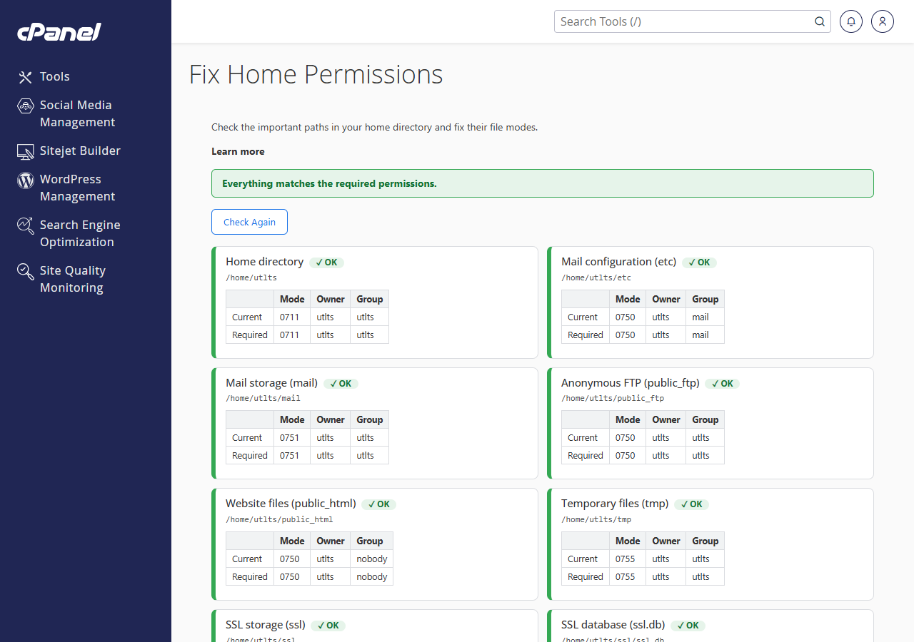
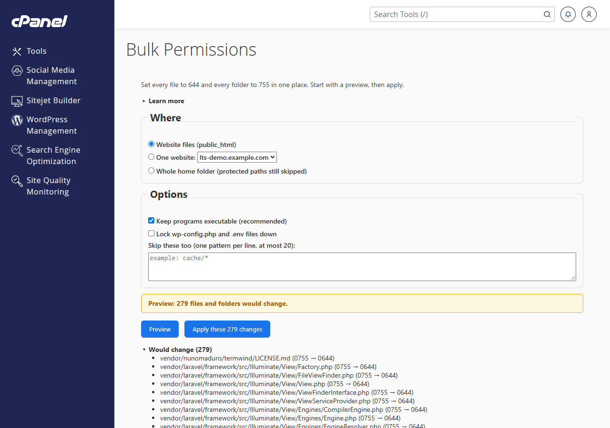
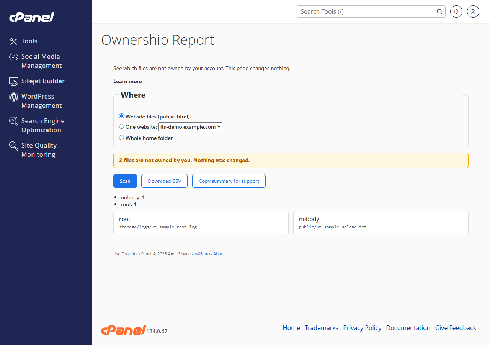
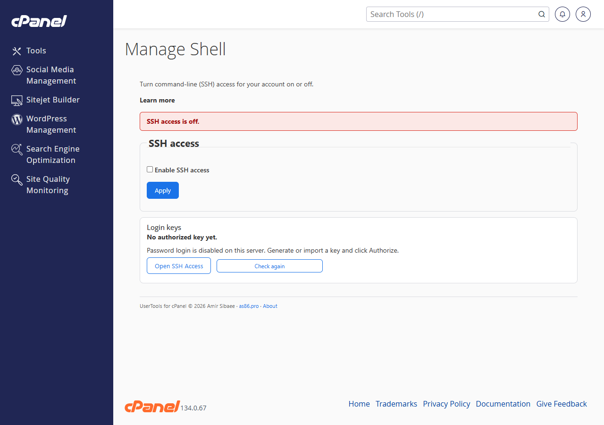
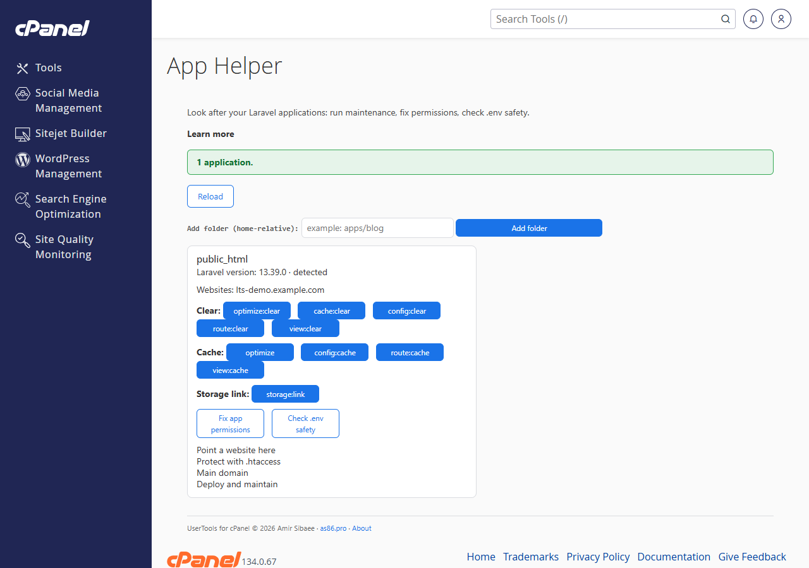
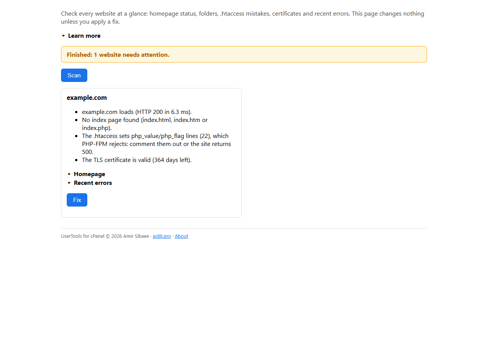
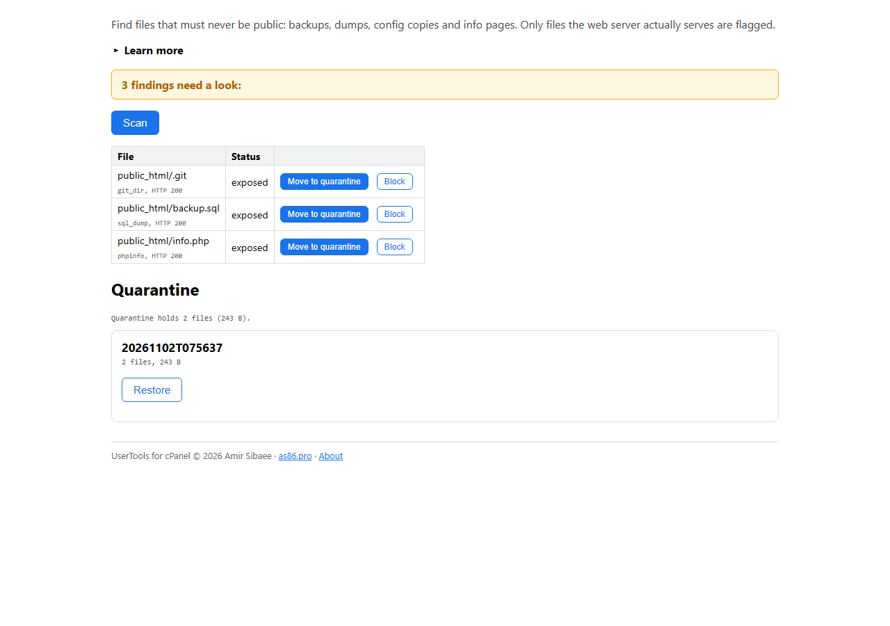
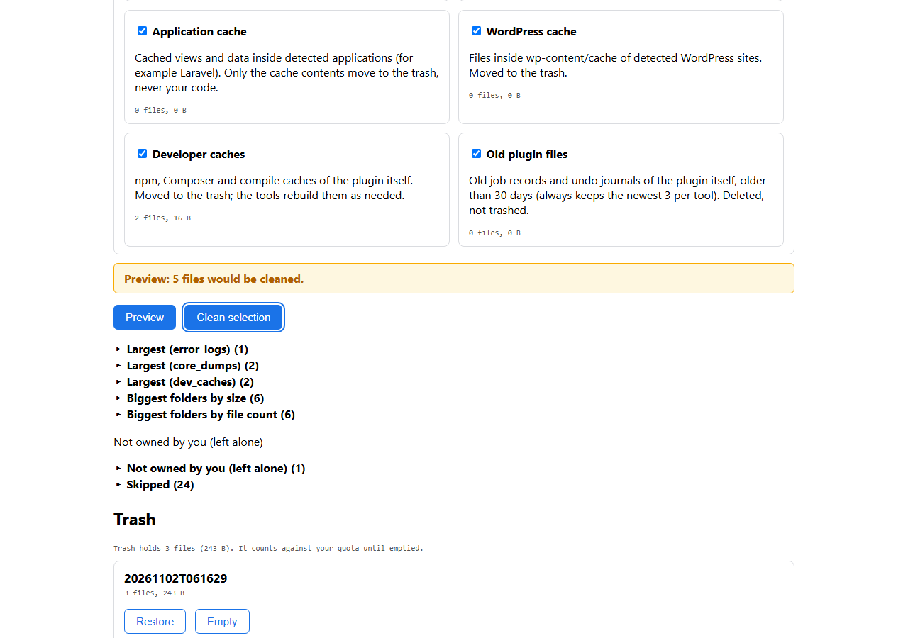
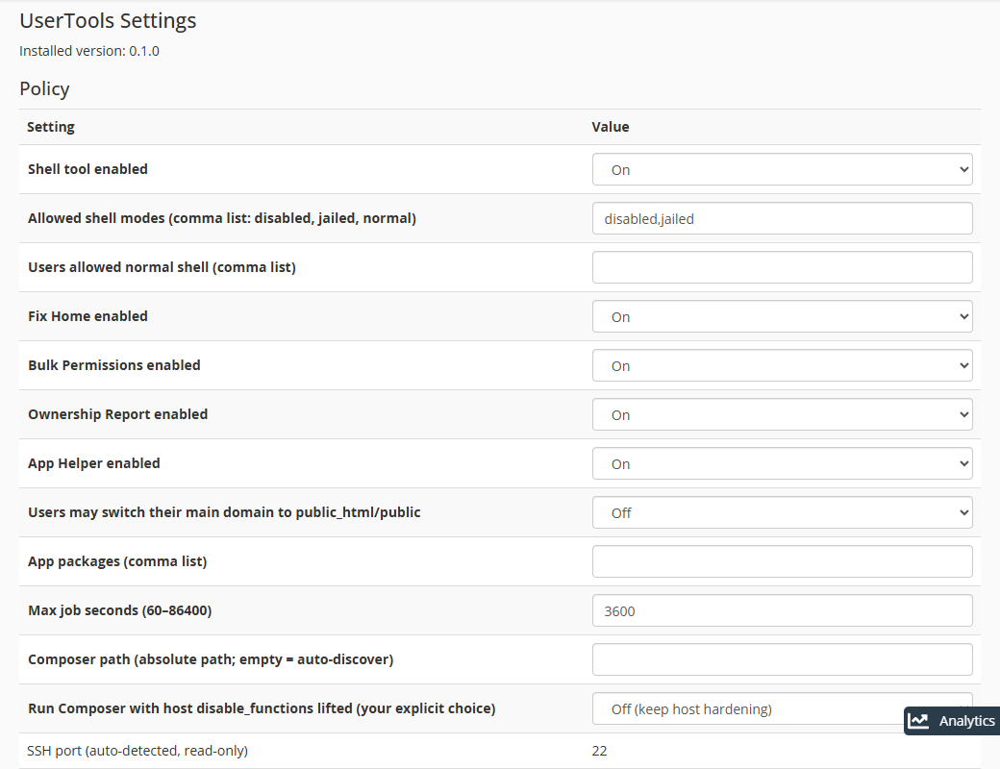

# UserTools for cPanel

Self-service tools for cPanel users, managed by the server admin.
Version 0.1.2 (public beta).

## Requirements

- cPanel & WHM 11.134 LTS or newer, with the Jupiter theme.
- Python 3.9 or newer on the server (used by the permission engine).
- Root access to install (users need no special access).

## Install (as root on the server)

One line (pinned release, verified download, then install):

```sh
curl -fsSL https://github.com/amirs86/usertools-for-cpanel/releases/download/v0.1.2/bootstrap-install.sh | bash -s -- \
    --repo amirs86/usertools-for-cpanel --version v0.1.2 --yes
```

Pinned install with checksum check (recommended when you want a fixed
version). Copy the expected hash from the release notes first:

```sh
curl -fsSLO https://github.com/amirs86/usertools-for-cpanel/releases/download/v0.1.2/usertools-for-cpanel-v0.1.2.tar.gz
curl -fsSLO https://github.com/amirs86/usertools-for-cpanel/releases/download/v0.1.2/usertools-for-cpanel-v0.1.2.tar.gz.sha256
sha256sum -c usertools-for-cpanel-v0.1.2.tar.gz.sha256
tar -xzf usertools-for-cpanel-v0.1.2.tar.gz && cd usertools-for-cpanel-*
./install.sh --yes
```

For extra safety, verify against the hash printed in the release notes
instead of the downloaded `.sha256` file (both files above come from the
same place, so that check only proves the download was not damaged):

```sh
./bootstrap-install.sh --repo amirs86/usertools-for-cpanel --version v0.1.2 --sha256 HEX --yes
```

## Verify a release

Every release attaches a Sigstore bundle (`.sigstore.json`) next to the
tarball: proof the tarball was built by this repo's release workflow from
the tagged commit — not merely that it downloaded intact. With
[cosign](https://github.com/sigstore/cosign) installed:

```sh
cosign verify-blob usertools-for-cpanel-v0.1.2.tar.gz \
    --bundle usertools-for-cpanel-v0.1.2.tar.gz.sigstore.json \
    --certificate-identity-regexp '^https://github.com/amirs86/usertools-for-cpanel/\.github/workflows/ci\.yml@refs/tags/v' \
    --certificate-oidc-issuer https://token.actions.githubusercontent.com
```

The one-liner above verifies automatically when cosign is present
(refusing on mismatch); without cosign it falls back to sha256 with a
warning. Pass `--require-signature` to refuse whenever verification is
impossible.

(The public repo is `amirs86/usertools-for-cpanel`. `./install.sh --dry-run`
shows what would change without changing anything.)

Upgrade (refreshes shipped files, adds missing policy keys, never
overwrites your settings):

```sh
./install.sh --upgrade --yes
```

Uninstall (removes the plugin; keeps the two policy files and the audit
log so a reinstall keeps your settings):

```sh
./uninstall.sh
```

Full removal including settings and log:

```sh
./uninstall.sh --purge
```

## After installing

1. WHM → Packages → Feature Manager: tick the eight `usertools_*`
   features for each package that should get the tools. Everything is
   **off by default** until you do this. (`./install.sh
   --enable-features=LIST` prints the exact steps for a list.)
2. WHM → Plugins → UserTools Settings: policy switches, shell modes,
   app packages, update check (opt-in, report only — never installs),
   automatic updates (opt-in), and the last 200 audit log lines. When the
   check finds a newer release, an "Update now" button downloads the
   signature-verified release and upgrades.
3. Try it on a throwaway account first before enabling it widely.

## Features

- Fix Home Permissions: check home folder modes and reset the key home folders to their required modes, with undo.
- Bulk Permissions: preview, then set 644/755 across home, public_html, or a document root, as a background job with progress, cancel, and undo.
- Ownership Report: read-only list of files not owned by the account, with CSV download for the host.
- Manage Shell: let users turn SSH access off, jailed, or normal (if you allow it), with policy gates and audit.
- App Helper: find web apps, run maintenance commands, install dependencies, view logs, manage the scheduler, check `.env` safety, and adjust document roots and `.htaccess` files.
- Space Cleaner: preview, then reclaim disk space and inodes (big logs, crash dumps, framework and WordPress caches, developer caches, old plugin files), with trash, restore, and empty.
- Site Doctor: check every website at a glance (homepage status, folders, `.htaccess` mistakes, certificates, recent errors), with one fix for php_value lines under PHP-FPM and undo.
- Exposed Files: find files that must never be public and probe whether the web server serves them, then move them to quarantine (restore) or block them with a marked `.htaccess` rule (undo).

## Tested

| Item | Status |
|---|---|
| 11.138 / AlmaLinux 9 | tested |
| 11.134 LTS / AlmaLinux 10 with CloudLinux CageFS | tested |
| Reseller-owned packages + account-creation hook (11.134 LTS) | tested |
| Signed update, repeat and rollback (11.134 LTS) | tested |
| Meridian | not supported yet: cPanel has no published plugin docs for it, and the pages do not load for accounts on Meridian (switch those accounts to Jupiter) |

## Security model

- No root file operations. Every file read or write runs as the cPanel
  user; the kernel's own permission checks are the boundary.
- Privileged calls take only enums and booleans (for example a shell
  mode, or on/off). No privileged call takes a path or file name.
- Every privileged call is gated by feature, policy, and caller: the
  server policy must allow it, the caller's package must include the
  feature, and the caller name comes from the server (never from the
  request).
- Features are off by default. Nothing is offered until you enable it
  per package in Feature Manager.
- Shell changes are read back and rolled back if the result is not what
  was asked for.
- No `.env` value ever leaves the server except `APP_ENV`/`APP_DEBUG`
  (for example in the production-switch change list and readiness
  counts). Full file contents are never returned.

## Requirements and notes

- Jailed shell is offered only when WHM → Tweak Settings → 'Use cPanel jailshell by default' is on; otherwise users can only turn SSH access off.
- Composer is looked up in this order: the `composer_path=` admin
  setting, then `/usr/local/bin/composer`, then
  `/opt/cpanel/composer/bin/composer`. The WHM page shows which one was
  found (each must be root-owned with no group/other write). Buttons
  that need Composer stay hidden when none is found.
- On CloudLinux with CageFS, the tools run inside the cage: a Composer
  or Node.js binary that exists on the host but is not mounted into the
  cage is reported as "found, but not visible to caged users" (App Helper
  hides that button). Expose it with a CageFS conf.d INI entry listing
  the path (for example `/etc/cagefs/conf.d/usertools-composer.cfg`
  with a `[usertools-composer]` section and a `paths=` list), then run
  `cagefsctl --force-update` — the WHM Composer row shows the exact entry
  (see the CloudLinux CageFS docs).
- The composer step passes `-d allow_url_fopen=1` to that one PHP
  process only (some servers ship PHP with URL downloads off, and
  Composer needs it). No php.ini file is ever changed, and the page
  says so.
- The "Restrict document roots to public_html" tweak (WHM → Tweak
  Settings → Domains) is honoured: when it is on and an app lives
  outside `public_html/`, the page explains instead of failing.
- Long jobs (permission runs, dependency installs) run detached with
  progress files under the user's own folder. One live job per scope;
  cancel is verified before any signal is sent.

## Policy reference

Public file `/etc/usertools.conf` (0644, safe to read). Never edited by
users; the installer creates it from the example and `--upgrade` only
adds missing keys:

- `enable_shell` (0/1): master switch for Manage Shell.
- `allowed_shell_modes` (list): which modes users may pick
  (`disabled`, `jailed`, plus `normal` only if you add it).
- `enable_fix_home`, `enable_bulk_perms`, `enable_ownership_report`,
  `enable_app_helper`, `enable_space_cleaner`, `enable_site_doctor`,
  `enable_exposed_files` (0/1): one switch per tool. The last three
  ship `0`: ticking their feature alone is not enough until you turn
  these on.
- `cleaner_log_min_mb` (number, MB, 1–1024, default 50): `error_log`
  and per-website PHP logs at or above this size qualify for
  truncating.
- `cleaner_trash_days` (number, days, 1–90, default 7): trash batches
  older than this are pruned at the start of every scan and run.
- `allow_user_app_docroot` (0/1): lets users point their own main
  domain at `public_html/public` themselves. Off by default.
- `app_packages` (list): new accounts on these packages get the app
  folder layout from the account-creation hook. Empty by default;
  names must match files in `/var/cpanel/packages/`.
- `max_job_seconds` (number): longest a background job may run.
- `enable_update_check` (0/1) + `update_repo` (owner/name, prefilled with
  `amirs86/usertools-for-cpanel`): opt-in check against the GitHub
  releases list. Report only, one short request, no data sent, never
  installs.
- `auto_update` (0/1) + `auto_update_scope` (`patch`/`minor`, default
  `patch`): daily automatic verified update (major releases never
  automatic). Off by default.
- `composer_path` (absolute path or empty): fixed Composer binary.
  Empty means auto-find (see the order above).
- `ssh_port` (number, read-only): filled in by the installer from the
  server's SSH settings. Shown on the Manage Shell page.

Private file `/etc/usertools.private.conf` (0600, root only). Read only
by privileged code, never sent to browsers:

- `normal_shell_users` (list): accounts allowed the full shell when
  `normal` is in `allowed_shell_modes`.
- `sshd_allowusers`, `sshd_allowgroups`, `sshd_denyusers`,
  `sshd_denygroups` (read-only, informational): copied from the
  server's SSH settings at install time. The Manage Shell page warns
  the user when these would still block their login.

## For server admins: fixing ownership (manual, optional)

The plugin never changes file ownership itself. There is no `chown` in
its code and no privileged path that accepts file names. If an Ownership
Report shows files owned by `root` or another account and you decide to
fix them yourself in a root shell:

1. Check hardlink protection first: `sysctl fs.protected_hardlinks`
   (expect `1`; turn it on before touching user files if it is off).
2. Fix the contents only, never the top folder itself. When FileProtect
   is on, `public_html` must stay `0750 user:nobody`, so a plain
   recursive change of `public_html` would lock the web server out
   (403). Stay inside the account, stay on the same disk, never follow
   links, and spare the top folder. Confirm the path first and never
   point the command at `/` or outside the account. If you change the
   top folder by accident with FileProtect on, set its group back to
   `nobody` right away.
3. Never run these on the account's `etc` or `mail` folders: those need
   a different group. For mail files use the server's mail permission
   script instead.
4. Afterwards, run Fix Home Permissions as the user to confirm every
   key path is green again.

## FAQ

**Does the user get root?**
No. Users only run code as themselves. The two privileged helpers
(shell change, main-domain document-root change) accept only
on/off-style values, check policy, package feature, and caller first,
write an audit line, and never touch user files.

**Why can't it fix ownership?**
By design. Changing owners needs root and file names together, which
is exactly what the plugin refuses to do. Ownership fixes stay a manual
admin step (see above) so a web bug can never turn into a takeover.

**Does the update check install anything?**
No. When you opt in, the WHM page makes one short web request to list
releases and tells you if a newer one exists. It never downloads or
installs.

## Screenshots

### Fix Home Permissions



### Bulk Permissions



### Ownership Report



### Manage Shell



### App Helper



### Site Doctor



### Exposed Files



### Space Cleaner



### WHM UserTools Settings



## License and attribution

Licensed under the Apache License, Version 2.0 (see `LICENSE`).
Redistributors: please keep the `NOTICE` file and the in-UI credit line
(`UserTools for cPanel © 2026 Amir Sibaee · as86.pro`) intact.

Not affiliated with or endorsed by cPanel, L.L.C.
Laravel is a trademark of Laravel Holdings Inc.; this project is not
affiliated with or endorsed by Laravel.
CloudLinux is a trademark of CloudLinux Inc.
